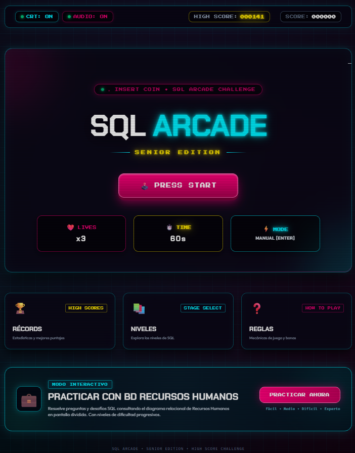
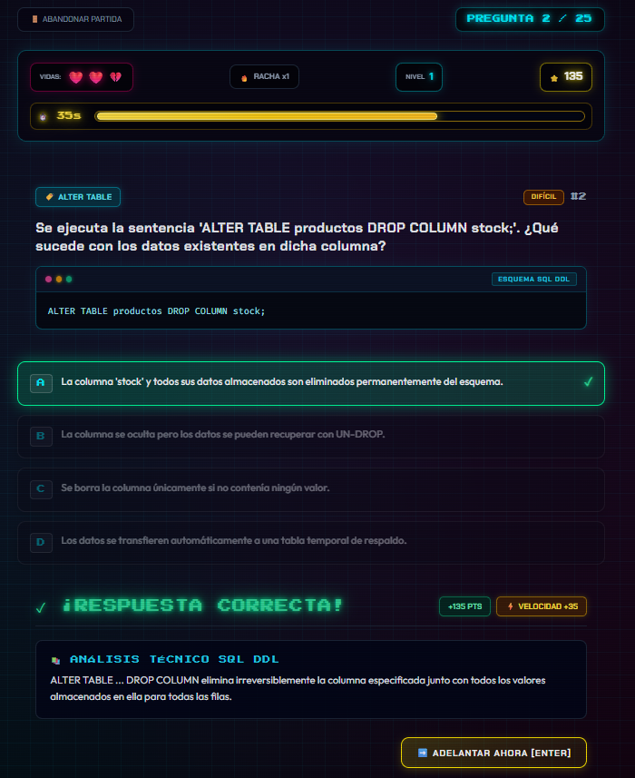
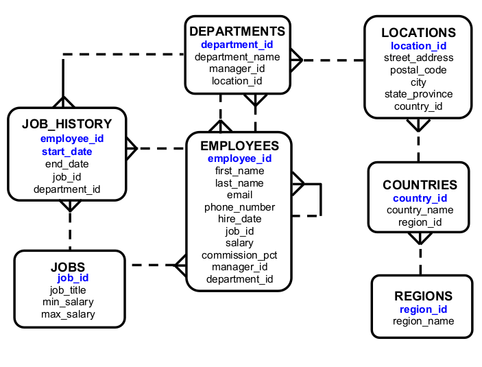

# 🎮 SQL ARCADE — SENIOR EDITION 🕹️

[](https://angular.dev/)
[](https://tailwindcss.com/)
[](https://www.typescriptlang.org/)
[](https://noemi2005.github.io/sql-arcade-game/)

> Un videojuego arcade educativo web interactivo diseñado para dominar el lenguaje SQL y la arquitectura de bases de datos relacionales con una estética retro de los años 80/90.

🌐 **Jugar en línea:** [https://noemi2005.github.io/sql-arcade-game/](https://noemi2005.github.io/sql-arcade-game/)

---

## 📸 Vistas de la Interfaz

| 🕹️ Lobby Principal (Arcade Stage) | ⚔️ Desafío en Partida |
| :---: | :---: |
|  |  |

### 💼 Modo Especial: Práctica con Base de Datos Recursos Humanos (HR)
> ¡Modo de entrenamiento interactivo! Resuelve consultas y desafíos relacionales observando el diagrama en tiempo real a pantalla dividida (preguntas a un lado, diagrama al otro, y opciones al ancho completo).

<div align="center">
  
</div>

---

## 🕹️ Características del Juego

- 👾 **Estética Arcade Retro:** Gabinete retro-futurista con efectos de tubo de rayos catódicos (CRT), luces de neón, tipografía arcade y animaciones dinámicas.
- 💼 **Modo Base de Datos Recursos Humanos (HR):** Entrena con esquemas reales (tablas `EMPLOYEES`, `DEPARTMENTS`, `JOBS`, `LOCATIONS`, `COUNTRIES`, `REGIONS`) con diagrama visible y soporte para zoom en alta definición.
- 🔊 **Efectos de Sonido 8-Bit:** Retroalimentación sonora en tiempo real para selecciones, respuestas correctas, errores, game over y cambio de nivel.
- 🧠 **Banco Dinámico de Preguntas:** Retos prácticos, depuración de consultas SQL y teoría relacional esencial.
- ⚡ **Sistema de Avance Progresivo:** Niveles de dificultad graduados (Fácil, Medio, Difícil, Experto).
- ⏱️ **Temporizador de 50s por Pregunta:** Tiempo justo para analizar diagramas y código sin perder la emoción arcade.
- 🏆 **Tabla de Récords Locales:** Persistencia de mejores puntuaciones en `localStorage` con rachas de aciertos y porcentajes de precisión.

---

## 🗺️ Estructura de Niveles

El jugador avanza automáticamente de nivel conforme supera los retos del arcade:

| Nivel | Categoría | Descripción y Temas |
| :---: | :--- | :--- |
| 🟢 **1** | **Teoría Básica** | Conceptos fundamentales: Tabla, Registro/Fila, Columna, Tipos de datos (`INT`, `VARCHAR`, `DECIMAL`, `DATE`), Claves (`PK`, `FK`), Clasificación de comandos (`DDL`, `DML`, `DQL`, `TCL`). |
| 🟢 **2** | **Definición Fundamental** | Sintaxis de creación de tablas, definición de campos e identificadores relacionales. |
| 🔵 **3** | **Claves Primarias y Restricciones** | Claves primarias (`PRIMARY KEY`), obligatoriedad (`NOT NULL`), unicidad (`UNIQUE`) y valores predeterminados (`DEFAULT`). |
| 🔵 **4** | **Claves Foráneas y Relaciones** | Modelado de relaciones, integridad referencial y enlaces entre tablas padre e hija. |
| 🟣 **5** | **Acciones Referenciales** | Comportamientos en cascada: `ON DELETE CASCADE`, `ON UPDATE SET NULL`, `RESTRICT` y `NO ACTION`. |
| 🟣 **6** | **Modificación de Tablas (ALTER)** | Alteración de estructuras existentes: `ALTER TABLE ADD`, `DROP COLUMN`, `MODIFY`. |
| 🔴 **7** | **Eliminación y Dependencias** | Eliminación segura de objetos: `DROP TABLE`, `TRUNCATE TABLE`, uso de `CASCADE` y `RESTRICT`. |
| 🔴 **8** | **Depurador SQL Avanzado** | Detección de fallos sintácticos, conflictos de tipos y ambigüedades en consultas reales. |
| ⚡ **9** | **Desafío de Orden y Dependencias** | Jerarquía de ejecución y relaciones complejas entre múltiples tablas. |
| 💼 **HR**| **Modo Especial Recursos Humanos** | Preguntas con esquema visual permanente de la base de datos Human Resources. |

---

## 🎮 Reglas del Juego

1. **Partida Estándar:** Cada intento consta de preguntas seleccionadas al azar según el modo.
2. **Vidas:** Inicias con **3 vidas (❤️ x3)**. Cada respuesta incorrecta o agotamiento del tiempo descuenta 1 vida.
3. **Tiempo por Pregunta:** Cuentas con **50 segundos** para responder.
4. **Multiplicadores y Bonos:** Responder con rapidez otorga puntos extra de velocidad, y encadenar aciertos activa multiplicadores por racha (1.5x, 2x, 3x).
5. **Navegación:** Al responder o agotarse el tiempo, podrás leer el análisis técnico detallado y avanzar pulsando <kbd>Enter</kbd> o el botón de avanzar.

---

## 🛠️ Tecnologías Utilizadas

- **Framework Core:** [Angular 19](https://angular.dev/) (Standalone Components, Signals & RxJS)
- **Estilos & Diseño:** [Tailwind CSS 3.4](https://tailwindcss.com/) & Estilos Arcade Neón Personalizados
- **Lenguaje:** [TypeScript 5.7](https://www.typescriptlang.org/)
- **Audio:** Web Audio API (Sintetizador de tonos 8-Bit)
- **Despliegue:** GitHub Actions & GitHub Pages

---

## 🚀 Instalación y Ejecución Local

Si deseas clonar y ejecutar el proyecto en tu máquina local:

### 1. Clonar el repositorio
```bash
git clone https://github.com/Noemi2005/sql-arcade-game.git
cd sql-arcade-game
```

### 2. Instalar dependencias
```bash
npm install
```

### 3. Iniciar el servidor de desarrollo
```bash
npm start
```

Abre tu navegador y entra a `http://localhost:4200/`.

---

## 📦 Compilación para Producción

Para compilar la aplicación:

```bash
npm run build:ghpages
```

Los archivos generados se ubicarán en el directorio `dist/sql-ddl-arcade/browser`.

---

## 📜 Licencia

Distribuido bajo la licencia MIT.
